<h2 align="center">I'm Alexander Urbaneja 👋  Product Engineer · Full Stack Developer with 5+ years building web applications in production.</h2>

ERP systems · e-commerce with point of sale · admin panels · brand websites

Next.js · React · TypeScript · Node.js · PostgreSQL · Caracas, Venezuela (UTC-4) · <b>Open to remote work</b>

###

  <b>FRONTEND</b> 
  
  
  
  
  
  
  
  
  
  
  
  
  
  
  
    
  <b>BACKEND AND DATABASES</b> 
  
  
  
  
  
  
  
  
  
  
  
  
  
  
  
    
  <b>TESTING AND DEVOPS</b> 
  
  
  
  
  
  
  
  
  
  
  
  
  
  
  
    
  <b>MOBILE</b> 
  
  
  
    
  <b>DESIGN AND VIDEO</b> 
  
  
  
  
  
  
  
    
  <b>SECURITY AND AUTHENTICATION</b> · Auth.js · Better Auth · OAuth 2.0 · RBAC · Row-Level Security · Two-factor authentication 
  <b>ALSO</b> · REST API design · SQL · S3 API · UI/UX design · Brand identity · Adobe Firefly

###

  
  
  

###

  

  

Click a card to open its official site. Ctrl or Cmd + click opens it in a new tab.

  <a href="https://www.salcelestialve.com"></a>
  <a href="https://www.allavenve.com"></a>
  <a href="https://www.bespokenve.com"></a>
  <a href="https://www.parmigianave.com"></a>
  <a href="https://www.luckyly.win"></a>
  <a href="https://www.osiiris.com"></a>
  

  

One e-commerce platform adapted into three stores. Finished and waiting for their own domain and content.

  
  
  

  

  
  

  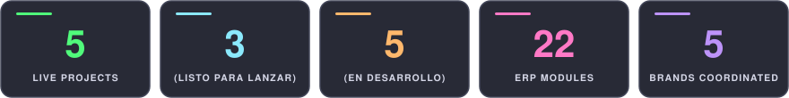

<b>Resumen en español</b>

 

Soy Alexander Urbaneja, Product Engineer y desarrollador Full Stack, con más de 5 años construyendo aplicaciones web en producción con Next.js, React, TypeScript, Node.js y PostgreSQL: sistemas ERP, e-commerce con punto de venta, paneles de administración y sitios de marca. Vivo en Caracas, Venezuela, y estoy disponible para trabajo remoto. La mayor parte de mi código es privada, así que aquí muestro resultados públicos: los sitios en producción tienen enlace, lo terminado que aún no se lanza lleva la etiqueta (Listo para lanzar) y lo que sigue en construcción, (En Desarrollo). Mi trabajo visual está en [Behance](https://www.behance.net/alestudiocreative).

  

###

 

<picture>
  <source media="(prefers-color-scheme: dark)" srcset="https://raw.githubusercontent.com/enyeralexander-rgb/enyeralexander-rgb/output/pacman-contribution-graph-dark.svg">
  <source media="(prefers-color-scheme: light)" srcset="https://raw.githubusercontent.com/enyeralexander-rgb/enyeralexander-rgb/output/pacman-contribution-graph.svg">
  
</picture>

###
